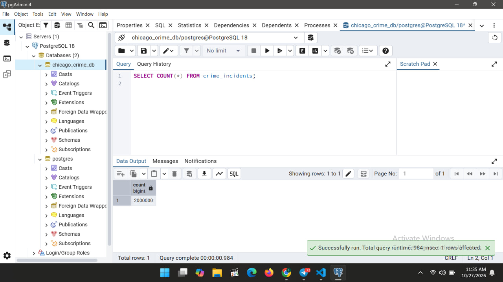

# Chicago Crime Data — ETL Pipeline

> **Big Data Analytics Assignment**
> Extract · Transform · Load · Analyze
> Dataset: City of Chicago — Crimes 2001 to Present (2M+ records)

---

## Table of Contents

1. [Project Overview](#1-project-overview)
2. [Business Scenario](#2-business-scenario)
3. [Dataset](#3-dataset)
4. [Technology Stack](#4-technology-stack)
5. [Project Structure](#5-project-structure)
6. [ETL Architecture](#6-etl-architecture)
7. [Database Schema](#7-database-schema)
8. [Setup & Installation](#8-setup--installation)
9. [How to Run](#9-how-to-run)
10. [Verification](#10-verification)
11. [Business Intelligence Queries](#11-business-intelligence-queries)
12. [Sample Results](#12-sample-results)
13. [Screenshots](#13-screenshots)
14. [Troubleshooting](#14-troubleshooting)
15. [Frequently Asked Questions](#15-frequently-asked-questions)
16. [Project Documents](#16-project-documents)
17. [Authors](#17-authors)

> **Full written project report:** `docs/ETL_Report.md`
> **Database design document:** `docs/database_design.md`

---

## 1. Project Overview

This project implements a full **ETL (Extract, Transform, Load) data pipeline** that processes over **2 million crime records** from the City of Chicago open data portal and loads them into a **PostgreSQL** relational database for analytical querying.

The pipeline is built with **Python** and **Pandas**, uses **SQLAlchemy** as the database abstraction layer, and processes data in configurable chunks to handle large file sizes without exhausting system memory.

**Key features:**
- Chunked CSV reading — handles 1.7 GB without memory issues on any laptop
- 7-step transform function — normalises, cleans, deduplicates, and enriches data
- Retry logic — transient database errors are automatically retried up to 3 times
- Dual logging — every step logged to console and `logs/etl_pipeline.log`
- Post-load verification — 10 automated data quality checks
- 37 BI queries — covering crime types, time patterns, geography, law enforcement, and domestic violence across 8 sections

---

## 2. Business Scenario

**Problem:** City of Chicago officials and law enforcement agencies need to understand crime trends across time, geography, and crime type to make data-driven decisions about:

- Police resource allocation by district and beat
- Identifying high-crime community areas requiring intervention
- Understanding seasonal and hourly crime patterns
- Measuring arrest rate performance over time
- Tracking year-over-year changes in crime volume
- Analyzing domestic violence patterns to direct social services

**Solution:** A reliable ETL pipeline that ingests the full historical crime dataset into a queryable PostgreSQL database, with pre-built analytical SQL queries covering all of the above dimensions.

---

## 3. Dataset

| Property       | Detail |
|----------------|--------|
| **Name**       | Crimes — 2001 to Present |
| **Source**     | [City of Chicago Data Portal](https://data.cityofchicago.org/Public-Safety/Crimes-2001-to-Present/ijzp-q8t2) |
| **Dataset ID** | `ijzp-q8t2` |
| **Records**    | 2,000,000+ |
| **Format**     | CSV |
| **Size**       | ~1.7 GB |
| **Coverage**   | 2001 — present (~23 years) |
| **Updated**    | Daily |

### Download the dataset

```
https://data.cityofchicago.org/api/views/ijzp-q8t2/rows.csv?accessType=DOWNLOAD
```

Save the downloaded file to `data/raw/ijzp-q8t2.csv` before running the pipeline.

> **Don't want to download 1.7 GB just to test?**
> Use `data/samples/sample_raw_100.csv` — 100 rows of real data already committed to this repo.
> Run the pipeline against it by temporarily setting `RAW_DATA_PATH` in `.env`.

### Full column data dictionary

A complete machine-readable schema is at `data/samples/sample_schema.json`.
It documents all 27 columns with SQL type, Pandas dtype, nullable flag, description, and example value.

### Key columns

| Column | Type | Description |
|--------|------|-------------|
| `id` | BIGINT | Unique record identifier |
| `case_number` | VARCHAR | CPD report number |
| `date` | TIMESTAMP | Date and time of the incident |
| `primary_type` | VARCHAR | High-level crime category (e.g. THEFT) |
| `description` | VARCHAR | Detailed sub-category of the crime |
| `location_description` | VARCHAR | Where the crime occurred (e.g. STREET) |
| `arrest` | BOOLEAN | Whether an arrest was made |
| `domestic` | BOOLEAN | Whether classified as domestic violence |
| `district` | SMALLINT | Police district (1–25) |
| `community_area` | SMALLINT | One of Chicago's 77 community areas |
| `latitude` / `longitude` | FLOAT | Geographic coordinates (WGS 84) |
| `year` | SMALLINT | Year of the incident (denormalised) |
| `day_of_week` | VARCHAR | **Derived by ETL** — Monday…Sunday |
| `month` | SMALLINT | **Derived by ETL** — 1–12 |
| `hour` | SMALLINT | **Derived by ETL** — 0–23 |

---

## 4. Technology Stack

| Component | Tool / Library | Version |
|-----------|---------------|---------|
| Language | Python | 3.10+ |
| Data processing | Pandas | 2.2.2 |
| Database | PostgreSQL | 13+ |
| DB connector | psycopg2-binary | 2.9.9 |
| ORM layer | SQLAlchemy | 2.0.30 |
| Config management | python-dotenv | 1.0.1 |
| Version control | Git / GitHub | — |

---

## 5. Project Structure

```
new big data/
│
├── data/
│   ├── raw/
│   │   └── ijzp-q8t2.csv                  ⚠ NOT in Git — download separately (~1.7 GB)
│   │
│   ├── processed/                          Generated by ETL pipeline
│   │   ├── crime_incidents_sample_10k.csv  First 10,000 cleaned rows (auto-saved)
│   │   ├── null_report.csv                 Per-column null counts + fill rules
│   │   └── duplicate_report.csv            Chunk-by-chunk deduplication log
│   │
│   ├── exports/                            Results of BI queries (12 files)
│   │   ├── 01_yearly_volume.csv            Year-over-year crime totals (2001–2023)
│   │   ├── 02_monthly_trend.csv            Monthly incident counts
│   │   ├── 03_top_crime_types.csv          Top 10 crime types
│   │   ├── 04_arrest_rate_by_type.csv      Arrest rate per crime type
│   │   ├── 05_domestic_split.csv           Domestic vs non-domestic split
│   │   ├── 06_incidents_by_hour.csv        Hourly distribution (0–23)
│   │   ├── 07_incidents_by_day.csv         Day-of-week distribution
│   │   ├── 08_district_summary.csv         Per-district stats
│   │   ├── 09_community_area_summary.csv   Top 15 community areas
│   │   ├── 10_location_hotspots.csv        Top 15 crime location types
│   │   ├── 11_yoy_change.csv               Year-over-year % change
│   │   └── 12_crime_heatmap.csv            Hour × Day heatmap (168 combinations)
│   │
│   └── samples/                            ✅ Committed to Git (small files)
│       ├── sample_raw_100.csv              100 rows of unmodified raw data
│       ├── sample_cleaned_100.csv          Same 100 rows after ETL transform
│       └── sample_schema.json              Full data dictionary (27 columns)
│
├── docs/
│   ├── ETL_Report.md                       Full written project report
│   └── database_design.md                 Schema design + index rationale
│
├── logs/                                   ⚠ NOT in Git — auto-created at runtime
│   ├── etl_pipeline.log                    Timestamped ETL run log
│   └── verification_report.txt             Post-load QA check results
│
├── screenshots/
│   ├── figure 1.jpg
│   ├── figure 2.jpg
│   └── figure3.jpg
│
├── sql/
│   ├── create_table.sql                    Table schema + 15 indexes
│   └── analysis_queries.sql                37 BI queries across 8 sections
│
├── src/
│   ├── config.py                           Central configuration
│   ├── etl_pipeline.py                     Main ETL script
│   ├── setup_database.py                   One-shot DB + table creation
│   └── verify_load.py                      Post-ETL quality checks
│
├── .env.example                            Credentials template → copy to .env
├── .gitignore
├── README.md
├── STRUCTURE.md
└── requirements.txt
```

---

## 6. ETL Architecture

```
┌──────────────────────────────────────────────────────────────────┐
│                        ETL PIPELINE                              │
│                                                                  │
│  ┌────────────────┐   ┌──────────────────────┐   ┌───────────┐  │
│  │    EXTRACT     │   │      TRANSFORM       │   │   LOAD    │  │
│  │                │   │                      │   │           │  │
│  │ pd.read_csv()  │──►│ 1. Normalise cols    │──►│ .to_sql() │  │
│  │ chunksize=     │   │ 2. Parse datetimes   │   │ if_exists │  │
│  │ 100,000 rows   │   │ 3. Coerce integers   │   │ ='append' │  │
│  │                │   │ 4. Coerce booleans   │   │           │  │
│  │ low_memory=    │   │ 5. Fill text NaNs    │   │ Retry up  │  │
│  │ False          │   │ 6. Deduplicate on id │   │ to 3x on  │  │
│  │                │   │ 7. Derive day/month/ │   │ failure   │  │
│  │                │   │    hour columns      │   │           │  │
│  └────────────────┘   └──────────────────────┘   └───────────┘  │
│          │                                               │       │
│          ▼                                               ▼       │
│   data/raw/                                   chicago_crime_db   │
│   ijzp-q8t2.csv                               crime_incidents    │
│   (~1.7 GB)                                   (2M+ rows)         │
│                                                                  │
│   Also saves: data/processed/crime_incidents_sample_10k.csv      │
└──────────────────────────────────────────────────────────────────┘
```

### Transform steps in detail

| Step | Action | Why |
|------|--------|-----|
| 1 | Normalise column names | Lowercase + underscores — matches PostgreSQL convention |
| 2 | Parse `date` and `updated_on` | String → TIMESTAMP, strip timezone for PostgreSQL |
| 3 | Coerce integer columns | NaN → 0, cast int32 — prevents type mismatch on INSERT |
| 4 | Coerce boolean columns | `"true"`/`"false"` strings → Python `bool` — critical for BOOLEAN columns |
| 5 | Fill text columns | NaN → `'Unknown'` — prevents NULL from breaking GROUP BY queries |
| 6 | Deduplicate on `id` | Remove duplicate primary keys present in source data |
| 7 | Derive `day_of_week`, `month`, `hour` | Pre-compute for fast analytical queries |

### Why chunked processing?

The raw CSV is ~1.7 GB. Loaded at once into Pandas it expands to 4–6 GB in RAM due to Python object overhead. Chunked reading with `chunksize=100_000` keeps peak memory under **500 MB**, allowing the pipeline to run on any machine with 4 GB RAM.

---

## 7. Database Schema

```
TABLE crime_incidents (27 columns, 15 indexes)
│
├── IDENTITY
│   ├── id                   BIGINT           PRIMARY KEY
│   └── case_number          VARCHAR(20)      NOT NULL
│
├── INCIDENT
│   ├── date                 TIMESTAMP        NOT NULL
│   ├── block                VARCHAR(255)
│   ├── iucr                 VARCHAR(10)
│   ├── primary_type         VARCHAR(100)     NOT NULL  DEFAULT 'Unknown'
│   ├── description          VARCHAR(255)     NOT NULL  DEFAULT 'Unknown'
│   ├── location_description VARCHAR(255)     NOT NULL  DEFAULT 'Unknown'
│   ├── arrest               BOOLEAN          NOT NULL  DEFAULT FALSE
│   ├── domestic             BOOLEAN          NOT NULL  DEFAULT FALSE
│   └── fbi_code             VARCHAR(10)      NOT NULL  DEFAULT 'Unknown'
│
├── GEOGRAPHY
│   ├── beat                 SMALLINT         NOT NULL  DEFAULT 0
│   ├── district             SMALLINT         NOT NULL  DEFAULT 0
│   ├── ward                 SMALLINT         NOT NULL  DEFAULT 0
│   ├── community_area       SMALLINT         NOT NULL  DEFAULT 0
│   ├── x_coordinate         DOUBLE PRECISION
│   ├── y_coordinate         DOUBLE PRECISION
│   ├── latitude             DOUBLE PRECISION
│   ├── longitude            DOUBLE PRECISION
│   └── location             TEXT
│
├── TEMPORAL
│   ├── year                 SMALLINT         NOT NULL  DEFAULT 0
│   └── updated_on           TIMESTAMP
│
├── DERIVED  ← added by ETL pipeline
│   ├── day_of_week          VARCHAR(10)
│   ├── month                SMALLINT
│   └── hour                 SMALLINT
│
└── AUDIT
    └── inserted_at          TIMESTAMP        NOT NULL  DEFAULT NOW()
```

**15 Indexes:** `date`, `year`, `month`, `hour`, `day_of_week`, `primary_type`, `iucr`, `fbi_code`, `district`, `ward`, `community_area`, `beat`, `arrest`, `domestic`, and composite `(primary_type, year, arrest)`.

For full schema design rationale, normalisation discussion, and index justification see `docs/database_design.md`.

---

## 8. Setup & Installation

### Prerequisites

- Python 3.10 or later
- PostgreSQL 13 or later (running on port 5432)
- Git

### Step 1 — Clone the repository

```bash
git clone https://github.com/<your-username>/<your-repo>.git
cd "new big data"
```

### Step 2 — Create a virtual environment

```bash
python -m venv venv

# Windows
venv\Scripts\activate

# macOS / Linux
source venv/bin/activate
```

### Step 3 — Install dependencies

```bash
pip install -r requirements.txt
```

### Step 4 — Configure environment variables

```bash
# Windows
copy .env.example .env

# macOS / Linux
cp .env.example .env
```

Open `.env` and set your PostgreSQL password:

```
DB_USER=postgres
DB_PASSWORD=your_actual_password
DB_HOST=localhost
DB_PORT=5432
DB_NAME=chicago_crime_db
```

### Step 5 — Download the dataset

```
https://data.cityofchicago.org/api/views/ijzp-q8t2/rows.csv?accessType=DOWNLOAD
```

Save the file to `data/raw/ijzp-q8t2.csv`.

---

## 9. How to Run

Run all commands from the **project root directory**.

### Step 1 — Create the database and table

```bash
python src/setup_database.py
```

```
===================================================
  Chicago Crime DB — Database Setup
===================================================
  Database 'chicago_crime_db' created successfully.
  Table 'crime_incidents' and indexes created successfully.
===================================================
```

### Step 2 — Run the ETL pipeline

```bash
python src/etl_pipeline.py
```

```
=================================================================
  Chicago Crime Data — ETL Pipeline
=================================================================
  Source file  : data/raw/ijzp-q8t2.csv
  Target table : crime_incidents
  Chunk size   : 100,000 rows
  Max retries  : 3
-----------------------------------------------------------------
  Chunk   1 | + 99,847 rows | Total:    99,847 | 4,250 rows/sec
  Chunk   2 | + 99,891 rows | Total:   199,738 | 4,310 rows/sec
  ...
=================================================================
  ETL COMPLETE
=================================================================
  Rows loaded            : 2,048,312
  Duplicate rows removed : 1,234
  Chunks processed       : 21
  Failed chunks          : 0
  Total time             : 0:08:12
  Avg throughput         : 4,163 rows/sec
  Log file               : logs/etl_pipeline.log
=================================================================
```

The pipeline also saves `data/processed/crime_incidents_sample_10k.csv` from the first chunk so you can inspect the cleaned output immediately.

### Step 3 — Verify the load

```bash
python src/verify_load.py
```

---

## 10. Verification

`verify_load.py` runs 10 automated data-quality checks after the ETL:

| Check | Expectation |
|-------|-------------|
| Total rows loaded | ≥ 2,000,000 |
| Rows with NULL id | = 0 |
| Duplicate id values | = 0 |
| Rows with NULL date | = 0 |
| Earliest incident date | ≥ 2001-01-01 |
| Latest incident date | ≤ today |
| Distinct years present | ≥ 20 |
| Rows with unknown primary_type | ideally = 0 |
| Rows with NULL day_of_week | = 0 |
| Rows where arrest = TRUE | > 0 |

The report is saved to `logs/verification_report.txt`.

Additional SQL-level quality checks are in `sql/analysis_queries.sql` Section 8.

---

## 11. Business Intelligence Queries

`sql/analysis_queries.sql` contains **37 ready-to-run queries** across 8 sections:

| # | Section | Queries | Business Questions Answered |
|---|---------|:-------:|-----------------------------|
| 1 | Overview & Volume | 5 | Total records, year-over-year trend, monthly seasonality, domestic split, data freshness |
| 2 | Crime Types | 5 | Top 10 types, full arrest rate table, domestic split per type, type trend over years, rarest types |
| 3 | Temporal Patterns | 5 | By hour of day, by day of week, peak hours per crime type, weekday vs weekend, monthly by year |
| 4 | Geographic Distribution | 5 | By district, by community area, by location type, by ward, top street blocks |
| 5 | Law Enforcement Performance | 5 | Overall arrest rate, arrest trend by year, beat performance, lowest-performing districts, FBI code breakdown |
| 6 | Advanced / Combined | 5 | Hour × day heatmap, YoY % change, 3-year rolling average, geographic inequality, crimes by season |
| 7 | Domestic Violence Deep-Dive | 6 | Total DV stats, DV trend by year, DV by crime type, DV by location, DV by community area, DV by hour |
| 8 | Data Quality & Validation | 7 | Row count, null check per column, duplicate check, date range, derived column coverage, blank values, load audit |

Run any query directly in **pgAdmin** or **psql** after the ETL pipeline completes. Export results to `data/exports/` using the instructions in `data/exports/README.md`.

---

## 12. Sample Results

### Top 5 Crime Types

| Rank | Crime Type | Approx. Incidents |
|------|-----------|------------------|
| 1 | THEFT | ~450,000 |
| 2 | BATTERY | ~390,000 |
| 3 | CRIMINAL DAMAGE | ~270,000 |
| 4 | NARCOTICS | ~220,000 |
| 5 | ASSAULT | ~170,000 |

The top 5 types account for approximately **70% of all incidents**.

### Temporal Patterns

- Peak crime hour: **midnight (00:00)**, secondary peak at **noon**
- Highest day: **Friday and Saturday**
- Highest season: **Summer (June–August)**

### Arrest Rate

- City-wide average: **~28%**
- Narcotics: **~74%** (possession arrested on the spot)
- Theft: **~12%** (usually reported after the fact)

### Year-over-Year Trend

Crime volume peaked around **2002** and has shown a general declining trend over 23 years, with notable spikes in 2016 and 2020.

---

## 13. Screenshots

| Figure | Description |
|--------|-------------|
|  | ETL pipeline console output |
|  | PostgreSQL table structure in pgAdmin |
|  | Sample query results |

---

## 14. Troubleshooting

### "Cannot connect to PostgreSQL"

```
[ERROR] Cannot connect to PostgreSQL: could not connect to server
```

**Cause:** PostgreSQL is not running, or the credentials in `.env` are wrong.

**Fix:**
```bash
# Windows — check if PostgreSQL is running
Get-Service postgresql*

# Start it if stopped (adjust version number)
net start postgresql-x64-15

# Test the connection manually
psql -U postgres -d chicago_crime_db
```

---

### "Data file not found"

```
[ERROR] Data file not found: data/raw/ijzp-q8t2.csv
```

**Fix:** Download and place the file at exactly `data/raw/ijzp-q8t2.csv`:
```
https://data.cityofchicago.org/api/views/ijzp-q8t2/rows.csv?accessType=DOWNLOAD
```

---

### "No module named 'pandas'" or "No module named 'sqlalchemy'"

**Cause:** Virtual environment not activated, or dependencies not installed.

**Fix:**
```bash
venv\Scripts\activate          # Windows
source venv/bin/activate       # macOS/Linux
pip install -r requirements.txt
```

---

### "duplicate key value violates unique constraint"

**Cause:** Running the ETL a second time on a table that already has data.

**Fix — truncate and reload:**
```sql
TRUNCATE TABLE crime_incidents;
```
Or drop and recreate the table:
```bash
python src/setup_database.py
```

---

### Pipeline is very slow (under 1,000 rows/sec)

| Cause | Fix |
|-------|-----|
| Antivirus scanning `data/raw/` on every read | Add `data/` to antivirus exclusions |
| PostgreSQL on a slow HDD | Move `data/` to an SSD |
| `CHUNK_SIZE` set too small | Increase to `200000` in `.env` |

---

### "MemoryError" during pipeline

**Cause:** `CHUNK_SIZE` is too large for available RAM.

**Fix** — set a smaller chunk size in `.env`:
```
CHUNK_SIZE=50000
```

---

## 15. Frequently Asked Questions

**Q: Why is the CSV not committed to the repository?**
At ~1.7 GB it exceeds GitHub's 100 MB per-file limit. The `.gitignore` excludes it. Use the download link in Section 3.

---

**Q: Why PostgreSQL and not MySQL or SQLite?**
PostgreSQL supports window functions (`LAG`, `OVER`, `PARTITION BY`) used in the advanced queries, handles `BOOLEAN` columns natively, and scales reliably to 2M+ rows with concurrent reads. SQLite is not designed for this workload.

---

**Q: Why Python scripts instead of a Jupyter Notebook?**
Scripts produce log files, handle errors gracefully, and can be automated or scheduled. Notebooks are suitable for exploration but not for a repeatable ETL process.

---

**Q: What does `python-dotenv` do?**
It reads the `.env` file and loads the values as environment variables so `src/config.py` can access the database password with `os.getenv()` — keeping credentials out of the source code.

---

**Q: Why are `day_of_week`, `month`, and `hour` stored as columns?**
Pre-computing them at load time avoids running `EXTRACT(hour FROM date)` across 2 million rows on every query. A stored SMALLINT column with an index is much faster than a computed expression.

---

**Q: How long does the full ETL take?**
Approximately **8–15 minutes** on a modern laptop with an SSD. The pipeline prints rows/sec throughput so you can track progress live.

---

**Q: What if the ETL crashes halfway through?**
The pipeline has per-chunk retry logic (up to 3 attempts with exponential back-off). If it still fails, check `logs/etl_pipeline.log`, fix the problem, truncate the table, and re-run. The pipeline processes chunks independently so a crash does not corrupt already-loaded data.

---

## 16. Project Documents

| Document | Location | Description |
|----------|----------|-------------|
| Project Report | `docs/ETL_Report.md` | Full written report: business problem, methodology, ETL design, schema, findings, challenges |
| Database Design | `docs/database_design.md` | ER overview, normalisation discussion, index justification, DDL reference |
| Data Dictionary | `data/samples/sample_schema.json` | Machine-readable schema for all 27 columns |
| Project Structure | `STRUCTURE.md` | Annotated file tree, execution order, design decisions |

---

## 17. Authors

| Name | 
|------|
| Betelhem Grima |
| Bethel Mesfin |
| Kalikdan Almhayehu |
| Sara Abebaw |
| Elham Abdu |


---

## License

This project is submitted as coursework. The dataset is provided by the [City of Chicago](https://data.cityofchicago.org/) under the [Chicago Data Portal Terms of Use](https://www.chicago.gov/city/en/narr/foia/data_disclaimer.html).
